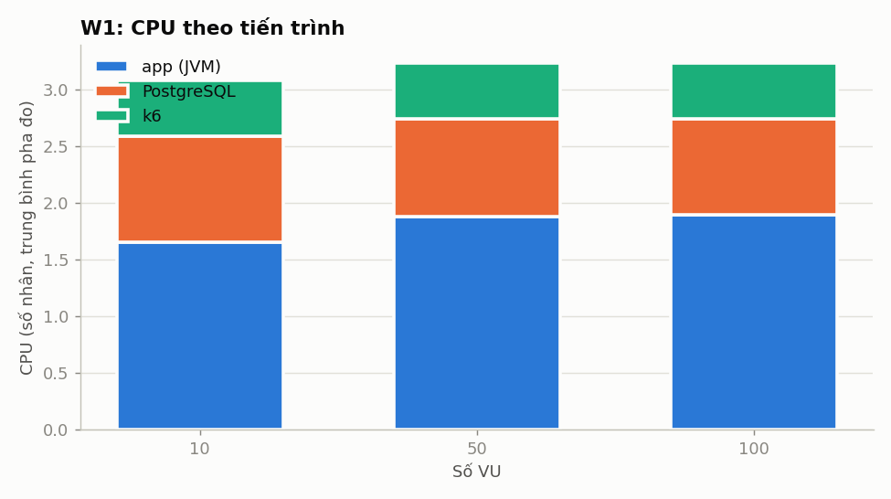
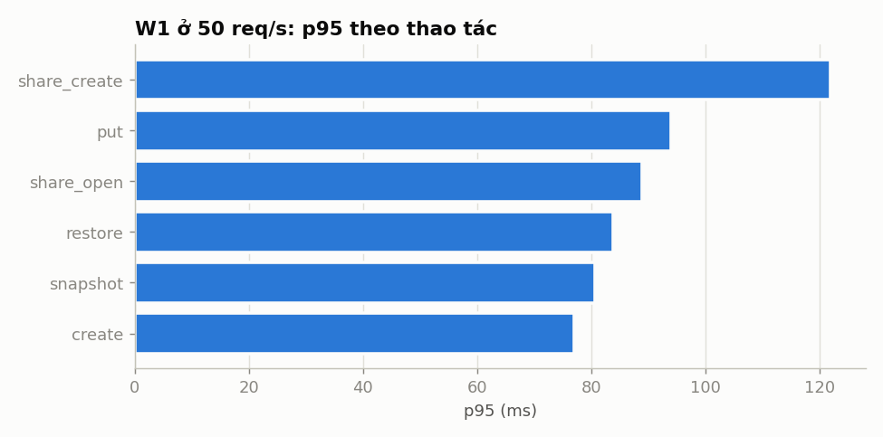
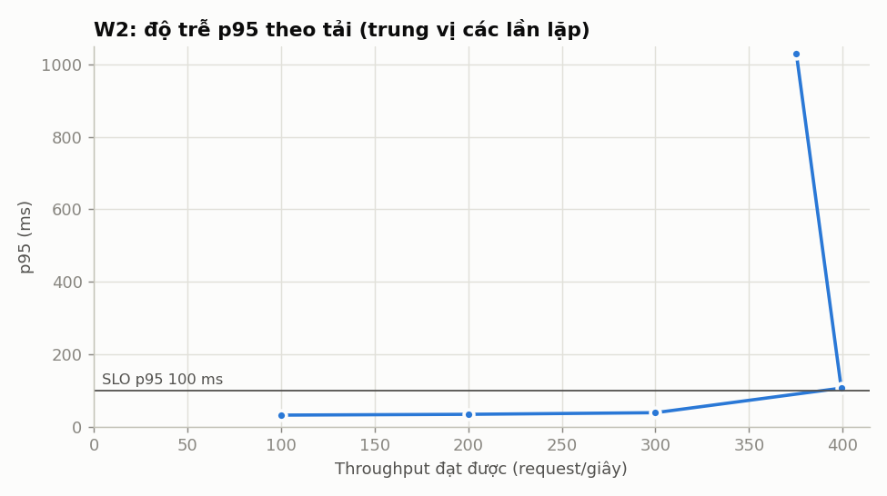
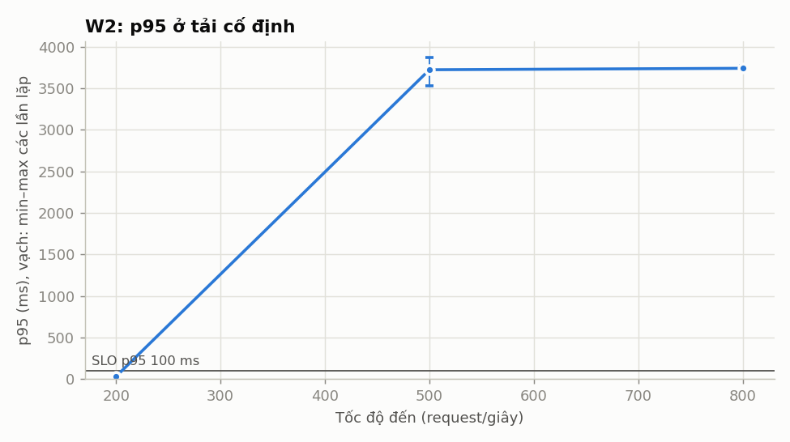
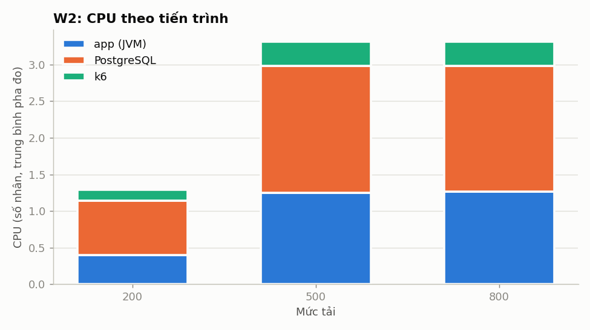
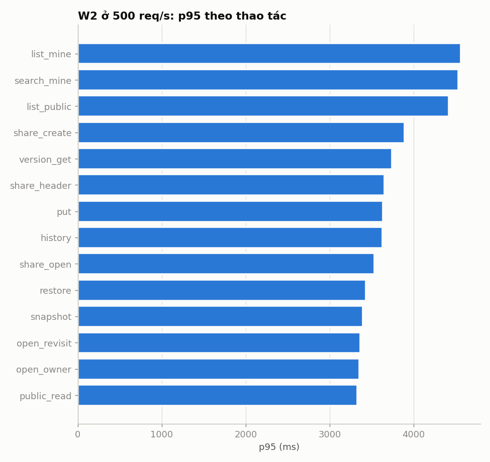
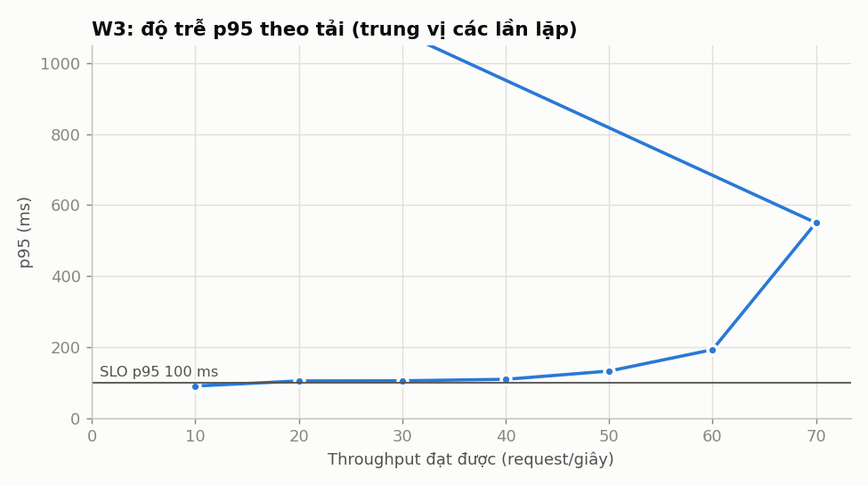
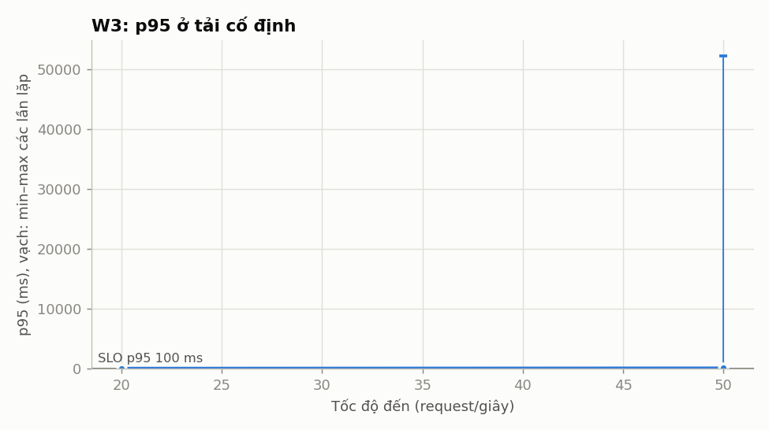
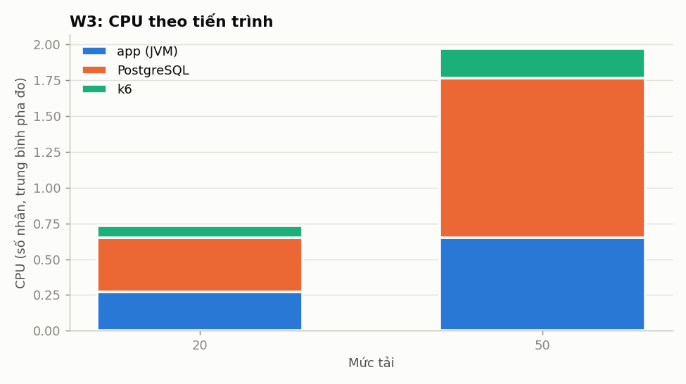
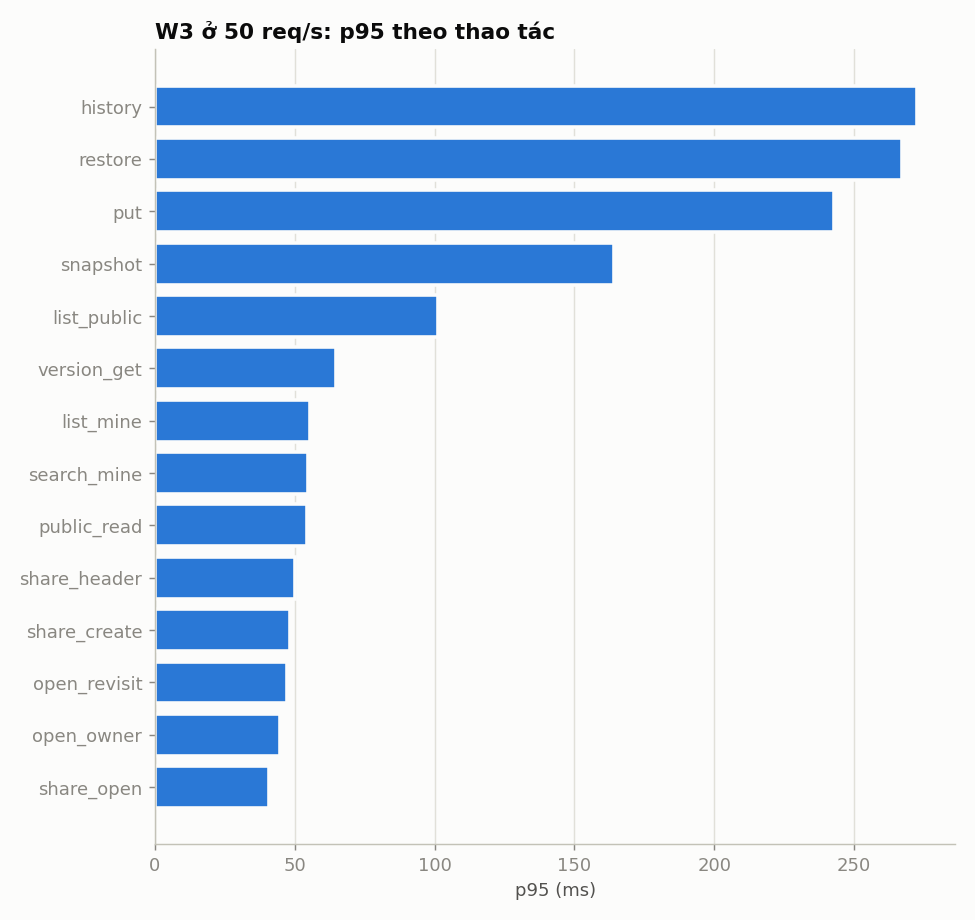

# Kết quả đo: 20261124-061459-m0

Sinh tự động bởi `bench/analysis/report.py`. Phương pháp: [ADR-0001](../../../docs/adr/0001-phuong-phap-do.md), cách chạy lại: [bench/README.md](../../README.md).

## Môi trường

- Máy: AMD EPYC 7B12, 4 vCPU (2 luồng/nhân), RAM 31Gi
- Hệ điều hành: Ubuntu 24.04.5 LTS
- Bố trí CPU: hệ thống được đo 0,1,2, tạo tải 3
- Phần mềm: openjdk version "21.0.13.1" 2026-11-17 LTS; k6 v2.3.0; PostgreSQL 16.16
- Cấu hình C0: `v2.0-m0` (commit `15f2356934`)
- Dữ liệu: scale 1.0, seed 20261123: 2000 user, 50000 sơ đồ (1582 MB data), 148345 phiên bản, 20000 link

## Kiểm tra tính hợp lệ của phép đo

| Lần chạy | Vấn đề |
|---|---|
| `C0_w2_fixed500_r1` | vượt sức chứa: chỉ đạt 420/500 req/s |
| `C0_w2_fixed500_r2` | vượt sức chứa: chỉ đạt 400/500 req/s |
| `C0_w2_fixed500_r3` | vượt sức chứa: chỉ đạt 390/500 req/s |
| `C0_w2_fixed500_rprof` | vượt sức chứa: chỉ đạt 384/500 req/s |
| `C0_w2_fixed800_r1` | vượt sức chứa: chỉ đạt 399/800 req/s |
| `C0_w2_fixed800_r2` | vượt sức chứa: chỉ đạt 393/800 req/s |
| `C0_w2_fixed800_r3` | vượt sức chứa: chỉ đạt 398/800 req/s |
| `C0_w3_capacityauto_r1` | 55 thao tác phải đổi sang đọc vì phân vùng của VU không có dữ liệu phù hợp (giảm MAX_VUS hoặc tăng SCALE) |
| `C0_w3_capacityauto_r2` | 51 thao tác phải đổi sang đọc vì phân vùng của VU không có dữ liệu phù hợp (giảm MAX_VUS hoặc tăng SCALE) |
| `C0_w3_capacityauto_r3` | 53 thao tác phải đổi sang đọc vì phân vùng của VU không có dữ liệu phù hợp (giảm MAX_VUS hoặc tăng SCALE) |
| `C0_w3_fixed20_r1` | 62 thao tác phải đổi sang đọc vì phân vùng của VU không có dữ liệu phù hợp (giảm MAX_VUS hoặc tăng SCALE) |
| `C0_w3_fixed20_r2` | 70 thao tác phải đổi sang đọc vì phân vùng của VU không có dữ liệu phù hợp (giảm MAX_VUS hoặc tăng SCALE) |
| `C0_w3_fixed20_r3` | 47 thao tác phải đổi sang đọc vì phân vùng của VU không có dữ liệu phù hợp (giảm MAX_VUS hoặc tăng SCALE) |
| `C0_w3_fixed50_r1` | vượt sức chứa: chỉ đạt 36/50 req/s; 112 lần 409 ngoài dự kiến (VU nhớ sai version: lỗi bộ đo); 98 thao tác phải đổi sang đọc vì phân vùng của VU không có dữ liệu phù hợp (giảm MAX_VUS hoặc tăng SCALE); lỗi 3.03% |
| `C0_w3_fixed50_r2` | 153 thao tác phải đổi sang đọc vì phân vùng của VU không có dữ liệu phù hợp (giảm MAX_VUS hoặc tăng SCALE) |
| `C0_w3_fixed50_r3` | 177 thao tác phải đổi sang đọc vì phân vùng của VU không có dữ liệu phù hợp (giảm MAX_VUS hoặc tăng SCALE) |
| `C0_w3_fixed50_rprof` | vượt sức chứa: chỉ đạt 26/50 req/s; 90 lần 409 ngoài dự kiến (VU nhớ sai version: lỗi bộ đo); 79 thao tác phải đổi sang đọc vì phân vùng của VU không có dữ liệu phù hợp (giảm MAX_VUS hoặc tăng SCALE); lỗi 6.32% |

## W1

### Mô hình tải đóng (số VU cố định, không nghỉ)

Trung vị (min–max) qua các lần lặp, chỉ tính pha đo.

| Cấu hình | VU | Throughput (req/s) | p50 (ms) | p95 (ms) | p99 (ms) | Lỗi | CPU app | CPU PostgreSQL | CPU k6 | Server trung bình (ms) | SQL/request | Khối TOAST/request | Trúng cache |
|---|---|---|---|---|---|---|---|---|---|---|---|---|---|
| C0 | 10 | 1503 (1434–1546) | 6.4 (6.3–6.7) | 10.8 (10.4–11.6) | 15.0 (14.1–16.1) | 0.00% | 1.65 (1.56–1.69) | 0.94 (0.91–0.95) | 0.49 (0.47–0.49) | 5.67 (5.52–5.95) | 3.33 (3.33–3.33) | 0.0 | – |
| C0 | 50 | 1286 (1273–1407) | 34.0 (31.2–34.5) | 93.8 (85.5–94.4) | 138.9 (125.8–139.5) | 0.00% | 1.88 (1.79–1.91) | 0.86 (0.85–0.89) | 0.49 (0.49–0.50) | 36.56 (33.46–36.94) | 3.33 (3.33–3.33) | 0.0 | – |
| C0 | 100 | 1253 (1221–1398) | 72.4 (65.0–74.5) | 208.2 (184.2–213.8) | 306.4 (275.6–314.1) | 0.00% | 1.90 (1.84–1.91) | 0.84 (0.82–0.89) | 0.50 (0.50–0.52) | 77.11 (68.80–79.02) | 3.33 (3.33–3.33) | 0.0 | – |

Phía server (trung vị qua các lần lặp). Transaction CSDL tính cả câu lệnh chạy autocommit, mỗi câu như vậy là một transaction riêng ở PostgreSQL:

| Cấu hình | VU | p95 server (ms) | Kết nối CSDL đang dùng | Chờ kết nối (max) | Luồng Tomcat bận (tb/max) | GC (ms/giây) | Transaction CSDL/request | Khối CSDL/request |
|---|---|---|---|---|---|---|---|---|
| C0 | 10 | 9.6 | 7.9 | 0 | 8.8/10 | 1.37 | 1.67 | 25.2 |
| C0 | 50 | 90.7 | 9.5 | 40 | 48.4/50 | 1.61 | 1.67 | 25.4 |
| C0 | 100 | 202.9 | 9.5 | 90 | 98.8/100 | 1.49 | 1.67 | 25.5 |

p95 theo thao tác ở mức 50 (ms, trung vị):

| Thao tác | C0 |
|---|---|
| share_create | 121.9 |
| put | 94.0 |
| share_open | 88.9 |
| restore | 83.7 |
| snapshot | 80.6 |
| create | 77.0 |

Câu SQL tốn thời gian nhất (`C0_w1_closed50_r1`):

| Lần gọi/request | Trung bình (ms) | % thời gian CSDL | Câu lệnh |
|---|---|---|---|
| 0.333 | 0.15 | 25% | `insert into diagram_versions (created_at,created_by,data,diagram_id,note,version_number,id) values ($1,$2,$3,$4,$5,$6,$7)` |
| 0.333 | 0.13 | 21% | `update diagrams set created_at=$1,data=$2,diagram_type=$3,is_public=$4,owner_id=$5,title=$6,updated_at=$7,updated_by=$8,version=$9 where ...` |
| 1.000 | 0.04 | 18% | `select … from diagrams de1_0 where de1_0.id=$1` |
| 0.167 | 0.14 | 11% | `insert into diagram_shares (created_at,diagram_id,role,share_token,id) values ($1,$2,$3,$4,$5)` |
| 0.167 | 0.14 | 11% | `insert into diagrams (created_at,data,diagram_type,is_public,owner_id,title,updated_at,updated_by,version,id) values ($1,$2,$3,$4,$5,$6,$...` |
| 0.333 | 0.03 | 5% | `select … from diagrams where id = $1 for update` |

## W2

### Sức chứa: throughput tối đa còn giữ p95 ≤ 100 ms, lỗi < 1%

| Cấu hình | Tốc độ tối đa đạt SLO (req/s) | Số lần lặp |
|---|---|---|
| C0 | 300 (300–400) | 3 |

Từng bậc tải (lần lặp đầu):

| Cấu hình | Mục tiêu | Đạt | p95 (ms) | p99 (ms) | Lỗi | CPU app | CPU PostgreSQL |
|---|---|---|---|---|---|---|---|
| C0 | 100 | 100 | 31.7 | 41.5 | 0.00% | 0.50 | 0.37 |
| C0 | 200 | 200 | 34.1 | 53.8 | 0.00% | 0.49 | 0.77 |
| C0 | 300 | 300 | 39.0 | 75.0 | 0.00% | 0.66 | 1.20 |
| C0 | 400 ✗ | 399 | 112.8 | 226.9 | 0.00% | 0.74 | 1.68 |
| C0 | 500 ✗ | 170 | 1077.9 | 1744.8 | 0.00% | 0.92 | 2.06 |

### Độ trễ ở tốc độ đến cố định

Trung vị (min–max) qua các lần lặp, chỉ tính pha đo.

| Cấu hình | Tốc độ đến | Throughput (req/s) | p50 (ms) | p95 (ms) | p99 (ms) | Lỗi | CPU app | CPU PostgreSQL | CPU k6 | Server trung bình (ms) | SQL/request | Khối TOAST/request | Trúng cache |
|---|---|---|---|---|---|---|---|---|---|---|---|---|---|
| C0 | 200 | 200 (200–200) | 2.2 (2.1–2.4) | 31.6 (31.5–33.3) | 51.9 (50.2–54.3) | 0.00% | 0.40 (0.37–0.43) | 0.74 (0.71–0.75) | 0.14 (0.14–0.15) | 5.84 (5.74–6.19) | 2.15 (2.15–2.15) | 6.3 (6.2–6.4) | – |
| C0 | 500 | 400 (390–420) | 2326.1 (2198.9–2408.6) | 3722.3 (3530.3–3871.3) | 4579.2 (4296.4–4739.9) | 0.00% | 1.25 (1.19–1.34) | 1.73 (1.64–1.79) | 0.34 (0.33–0.35) | 497.46 (473.95–509.79) | 2.14 (2.14–2.15) | 6.5 (6.3–6.6) | – |
| C0 | 800 | 398 (393–399) | 2346.5 (2342.3–2384.8) | 3739.6 (3727.9–3768.8) | 4567.7 (4542.1–4590.5) | 0.00% | 1.26 (1.21–1.27) | 1.72 (1.71–1.77) | 0.33 (0.33–0.33) | 501.24 (498.87–506.99) | 2.14 (2.14–2.15) | 6.5 (6.4–6.8) | – |

Phía server (trung vị qua các lần lặp). Transaction CSDL tính cả câu lệnh chạy autocommit, mỗi câu như vậy là một transaction riêng ở PostgreSQL:

| Cấu hình | Tốc độ đến | p95 server (ms) | Kết nối CSDL đang dùng | Chờ kết nối (max) | Luồng Tomcat bận (tb/max) | GC (ms/giây) | Transaction CSDL/request | Khối CSDL/request |
|---|---|---|---|---|---|---|---|---|
| C0 | 200 | 31.0 | 1.1 | 0 | 1.2/5 | 0.81 | 1.85 | 835.3 |
| C0 | 500 | 1690.0 | 9.7 | 191 | 200.0/200 | 14.08 | 1.85 | 863.8 |
| C0 | 800 | 1705.9 | 9.8 | 191 | 200.0/200 | 13.78 | 1.85 | 875.1 |

p95 theo thao tác ở mức 500 (ms, trung vị):

| Thao tác | C0 |
|---|---|
| list_mine | 4565.3 |
| search_mine | 4531.5 |
| list_public | 4420.8 |
| share_create | 3892.0 |
| version_get | 3741.9 |
| share_header | 3655.2 |
| put | 3633.7 |
| history | 3630.6 |
| share_open | 3530.4 |
| restore | 3432.9 |
| snapshot | 3396.4 |
| open_revisit | 3367.9 |
| open_owner | 3352.5 |
| public_read | 3330.9 |

Câu SQL tốn thời gian nhất (`C0_w2_fixed500_r1`):

| Lần gọi/request | Trung bình (ms) | % thời gian CSDL | Câu lệnh |
|---|---|---|---|
| 0.101 | 64.40 | 46% | `select … from diagrams de1_0 where de1_0.is_public` |
| 0.118 | 19.05 | 16% | `select … from diagrams de1_0 where de1_0.owner_id=$1 fetch first $2 rows only` |
| 0.082 | 17.10 | 10% | `select … from diagrams de1_0 where de1_0.owner_id=$1 and upper(de1_0.title) like upper($2) escape $4 fetch first $3 rows only` |
| 0.036 | 36.61 | 9% | `select … from diagrams de1_0 where de1_0.is_public offset $1 rows fetch first $2 rows only` |
| 0.928 | 1.08 | 7% | `select … from diagrams de1_0 where de1_0.id=$1` |
| 0.061 | 11.77 | 5% | `select … from diagrams de1_0 where de1_0.owner_id=$1 and upper(de1_0.title) like upper($2) escape $3` |

## W3

### Sức chứa: throughput tối đa còn giữ p95 ≤ 100 ms, lỗi < 1%

| Cấu hình | Tốc độ tối đa đạt SLO (req/s) | Số lần lặp |
|---|---|---|
| C0 | 10 (10–30) | 3 |

Từng bậc tải (lần lặp đầu):

| Cấu hình | Mục tiêu | Đạt | p95 (ms) | p99 (ms) | Lỗi | CPU app | CPU PostgreSQL |
|---|---|---|---|---|---|---|---|
| C0 | 10 | 10 | 84.0 | 106.4 | 0.00% | 0.18 | 0.18 |
| C0 | 20 ✗ | 20 | 104.5 | 127.8 | 0.00% | 0.39 | 0.42 |
| C0 | 30 ✗ | 30 | 108.8 | 138.9 | 0.00% | 0.43 | 0.64 |
| C0 | 40 ✗ | 40 | 109.0 | 149.2 | 0.00% | 0.57 | 0.87 |
| C0 | 50 ✗ | 50 | 146.9 | 409.4 | 0.00% | 0.67 | 1.15 |
| C0 | 60 ✗ | 60 | 238.5 | 451.6 | 0.00% | 0.94 | 1.47 |
| C0 | 70 ✗ | 70 | 550.3 | 866.3 | 0.00% | 0.90 | 1.90 |
| C0 | 80 ✗ | 3 | 1449.4 | 1666.0 | 0.00% | 1.00 | 1.99 |

### Độ trễ ở tốc độ đến cố định

Trung vị (min–max) qua các lần lặp, chỉ tính pha đo.

| Cấu hình | Tốc độ đến | Throughput (req/s) | p50 (ms) | p95 (ms) | p99 (ms) | Lỗi | CPU app | CPU PostgreSQL | CPU k6 | Server trung bình (ms) | SQL/request | Khối TOAST/request | Trúng cache |
|---|---|---|---|---|---|---|---|---|---|---|---|---|---|
| C0 | 20 | 20 | 18.5 (18.4–18.7) | 90.9 (89.8–94.0) | 118.1 (117.0–119.1) | 0.00% | 0.27 (0.27–0.27) | 0.38 (0.38–0.38) | 0.08 (0.08–0.08) | 27.20 (26.73–27.55) | 2.13 (2.13–2.14) | 80.2 (80.1–81.5) | – |
| C0 | 50 | 50 (36–50) | 21.6 (20.4–7813.3) | 141.9 (121.6–52269.8) | 238.0 (182.1–60000.2) | 0.00% (0.00–3.03) | 0.65 (0.62–1.82) | 1.11 (1.02–1.15) | 0.21 (0.20–0.21) | 39.97 (35.65–4193.26) | 2.09 (2.09–2.11) | 89.4 (84.4–90.0) | – |

Phía server (trung vị qua các lần lặp). Transaction CSDL tính cả câu lệnh chạy autocommit, mỗi câu như vậy là một transaction riêng ở PostgreSQL:

| Cấu hình | Tốc độ đến | p95 server (ms) | Kết nối CSDL đang dùng | Chờ kết nối (max) | Luồng Tomcat bận (tb/max) | GC (ms/giây) | Transaction CSDL/request | Khối CSDL/request |
|---|---|---|---|---|---|---|---|---|
| C0 | 20 | 89.4 | 0.3 | 0 | 0.9/2 | 2.29 | 1.89 | 875.2 |
| C0 | 50 | 141.6 | 1.9 | 0 | 2.3/7 | 5.17 | 1.93 | 902.4 |

p95 theo thao tác ở mức 50 (ms, trung vị):

| Thao tác | C0 |
|---|---|
| history | 272.6 |
| restore | 267.2 |
| put | 243.0 |
| snapshot | 164.3 |
| list_public | 101.2 |
| version_get | 64.9 |
| list_mine | 55.5 |
| search_mine | 54.7 |
| public_read | 54.4 |
| share_header | 50.2 |
| share_create | 48.3 |
| open_revisit | 47.2 |
| open_owner | 44.8 |
| share_open | 40.8 |

Câu SQL tốn thời gian nhất (`C0_w3_fixed50_r1`):

| Lần gọi/request | Trung bình (ms) | % thời gian CSDL | Câu lệnh |
|---|---|---|---|
| 0.897 | 92.16 | 57% | `select … from diagrams de1_0 where de1_0.id=$1` |
| 0.076 | 207.46 | 11% | `update diagrams set created_at=$1,data=$2,diagram_type=$3,is_public=$4,owner_id=$5,title=$6,updated_at=$7,updated_by=$8,version=$9 where ...` |
| 0.098 | 108.59 | 7% | `select … from diagrams de1_0 where de1_0.is_public` |
| 0.116 | 90.79 | 7% | `select … from diagrams de1_0 where de1_0.owner_id=$1 fetch first $2 rows only` |
| 0.057 | 150.89 | 6% | `select … from diagram_versions dve1_0 where dve1_0.diagram_id=$1 order by dve1_0.version_number desc` |
| 0.038 | 198.57 | 5% | `insert into diagram_versions (created_at,created_by,data,diagram_id,note,version_number,id) values ($1,$2,$3,$4,$5,$6,$7)` |

## Flame graph CPU

Lấy ở giữa pha đo, lần chạy riêng không tính vào số liệu ở trên.

- `C0_w2_fixed500_rprof`: [flame.html](C0_w2_fixed500_rprof/flame.html) (sự kiện `cpu`)
- `C0_w3_fixed50_rprof`: [flame.html](C0_w3_fixed50_rprof/flame.html) (sự kiện `cpu`)

