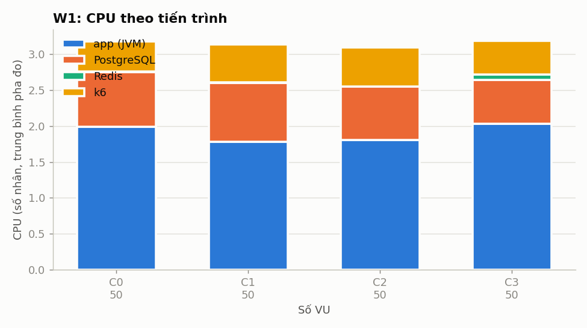
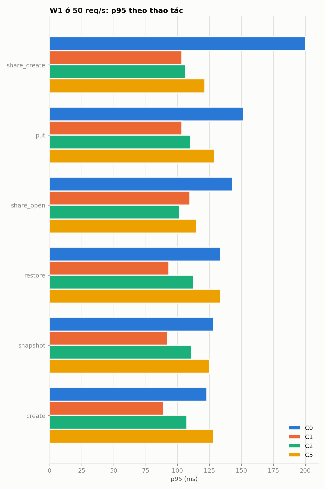
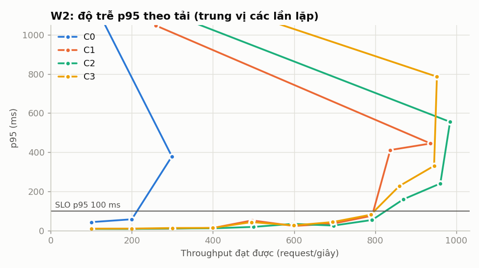
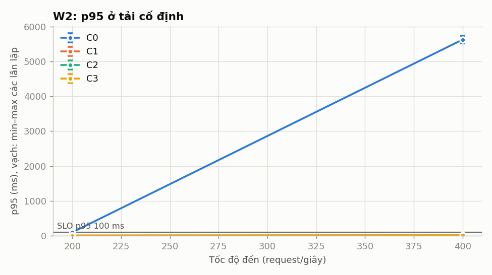
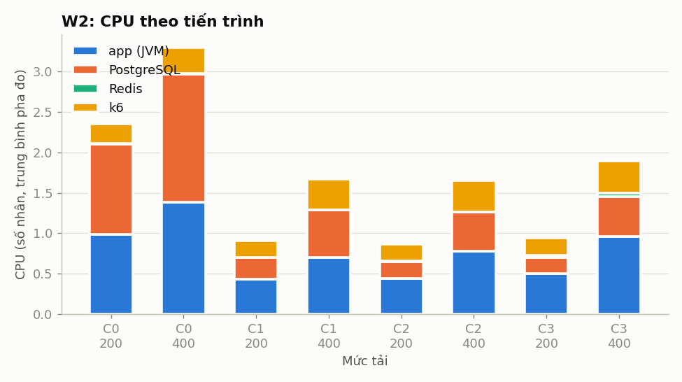
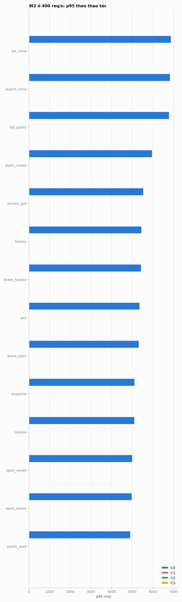
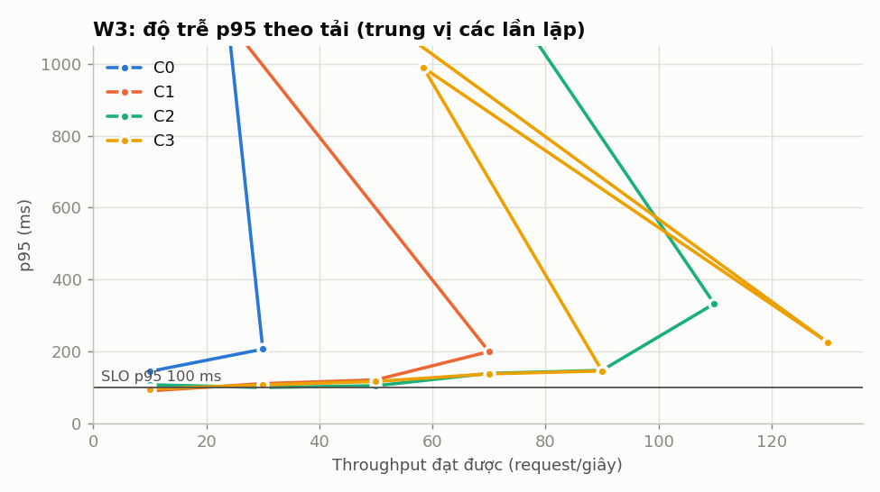
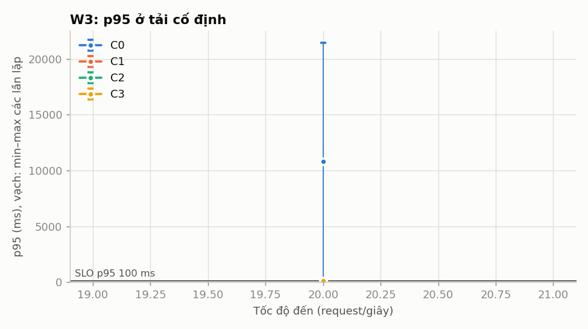
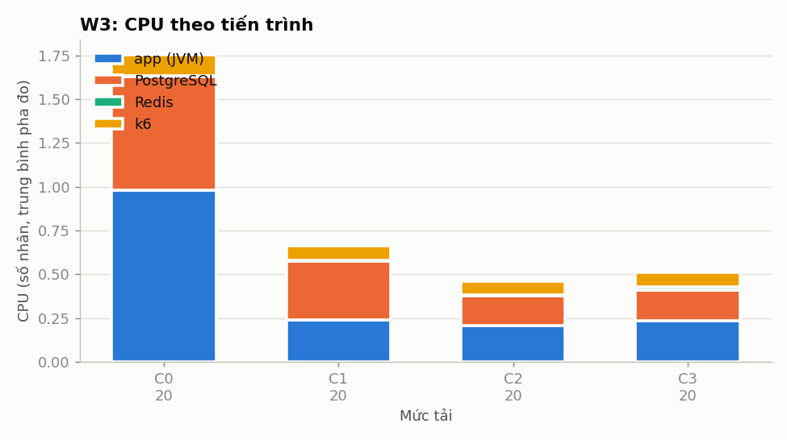
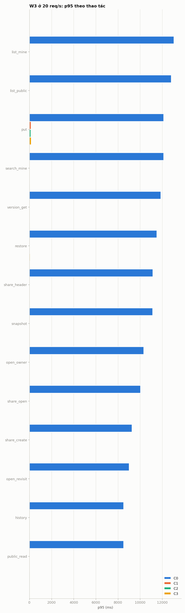

# Kết quả đo: 20261126-144513-b12

Sinh tự động bởi `bench/analysis/report.py`. Phương pháp: [ADR-0001](../../../docs/adr/0001-phuong-phap-do.md), cách chạy lại: [bench/README.md](../../README.md).

## Môi trường

- Máy: Intel(R) Xeon(R) CPU @ 2.20GHz, 4 vCPU (2 luồng/nhân), RAM 31Gi
- Hệ điều hành: Ubuntu 24.04.5 LTS
- Bố trí CPU: hệ thống được đo ?, tạo tải 3
- Phần mềm: openjdk version "21.0.13.1" 2026-11-17 LTS; k6 v2.3.0; PostgreSQL 16.16
- Cấu hình C0: `v2.0-m0` (commit `15f2356934`)
- Cấu hình C1: `v2.1-b1` (commit `1383937b65`)
- Cấu hình C2: `v2.2-b2` (commit `3aa8d6a5c5`), tham số `--diagramio.cache.mode=local`
- Cấu hình C3: `v2.2-b2` (commit `3aa8d6a5c5`), tham số `--diagramio.cache.mode=two-level`
- Dữ liệu: scale 1.0, seed 20261123: 2000 user, 50000 sơ đồ (1582 MB data), 148345 phiên bản, 20000 link

## Kế hoạch thực thi (EXPLAIN ANALYZE, BUFFERS)

Mỗi câu chạy 3 lần, giữ lần cuối (cache đã ấm). Kế hoạch đầy đủ trong `explain-<cấu hình>.txt`.

| Cấu hình | Câu truy vấn | Thời gian (ms) | Khối đọc từ bộ đệm | Khối đọc từ đĩa | Dòng trả về | Nút gốc / quét đầu tiên |
|---|---|---|---|---|---|---|
| C0 | public_count | 19.809 | 6144 | 0 | 1 | Aggregate / Seq Scan |
| C0 | public_page10 | 1.287 | 265 | 0 | 20 | Limit / Seq Scan |
| C0 | mine_page | 0.282 | 35 | 0 | 20 | Limit / Seq Scan |
| C0 | mine_count | 7.552 | 3096 | 0 | 1 | Aggregate / Bitmap Heap Scan |
| C0 | search_page | 2.343 | 284 | 0 | 20 | Limit / Bitmap Heap Scan |
| C0 | search_count | 10.828 | 3096 | 0 | 1 | Aggregate / Bitmap Heap Scan |
| C0 | shares | 2.515 | 308 | 0 | 80 | Seq Scan / Seq Scan |
| C0 | history | 2.876 | 310 | 0 | 389 | Sort / Bitmap Heap Scan |
| C1 | public_page10 | 2.454 | 251 | 0 | 20 | Nested Loop / Index Only Scan idx_diagrams_public_updated |
| C1 | mine_page | 1.277 | 57 | 0 | 20 | Nested Loop / Index Only Scan idx_diagrams_owner_updated |
| C1 | search_page | 6.595 | 706 | 0 | 20 | Nested Loop / Bitmap Heap Scan |
| C1 | shares | 0.500 | 76 | 0 | 80 | Bitmap Heap Scan / Bitmap Heap Scan |
| C1 | history | 2.155 | 310 | 0 | 389 | Sort / Bitmap Heap Scan |

## Kiểm tra tính hợp lệ của phép đo

| Lần chạy | Vấn đề |
|---|---|
| `C0_w2_fixed200_r1` | 694 iteration bị bỏ (thiếu VU sẵn sàng); CPU app ở phần ba đầu pha đo cao hơn phần ba cuối 194%: JVM chưa ấm hết sau warm-up (tăng WARMUP) |
| `C0_w2_fixed200_r2` | 510 iteration bị bỏ (thiếu VU sẵn sàng); CPU app ở phần ba đầu pha đo cao hơn phần ba cuối 150%: JVM chưa ấm hết sau warm-up (tăng WARMUP) |
| `C0_w2_fixed400_r1` | vượt sức chứa: chỉ đạt 257/400 req/s; CPU app ở phần ba đầu pha đo cao hơn phần ba cuối 36%: JVM chưa ấm hết sau warm-up (tăng WARMUP) |
| `C0_w2_fixed400_r2` | vượt sức chứa: chỉ đạt 262/400 req/s |
| `C0_w2_fixed400_rprof` | vượt sức chứa: chỉ đạt 247/400 req/s; CPU app ở phần ba đầu pha đo cao hơn phần ba cuối 29%: JVM chưa ấm hết sau warm-up (tăng WARMUP) |
| `C0_w3_fixed20_r2` | vượt sức chứa: chỉ đạt 17/20 req/s; CPU app ở phần ba đầu pha đo cao hơn phần ba cuối 394%: JVM chưa ấm hết sau warm-up (tăng WARMUP) |
| `C1_w2_fixed200_r1` | CPU app ở phần ba đầu pha đo cao hơn phần ba cuối 31%: JVM chưa ấm hết sau warm-up (tăng WARMUP) |
| `C1_w2_fixed200_r2` | CPU app ở phần ba đầu pha đo cao hơn phần ba cuối 29%: JVM chưa ấm hết sau warm-up (tăng WARMUP) |
| `C1_w2_fixed400_r1` | CPU app ở phần ba đầu pha đo cao hơn phần ba cuối 65%: JVM chưa ấm hết sau warm-up (tăng WARMUP) |
| `C1_w2_fixed400_r2` | CPU app ở phần ba đầu pha đo cao hơn phần ba cuối 64%: JVM chưa ấm hết sau warm-up (tăng WARMUP) |
| `C1_w2_fixed400_rprof` | CPU app ở phần ba đầu pha đo cao hơn phần ba cuối 79%: JVM chưa ấm hết sau warm-up (tăng WARMUP) |
| `C2_w2_capacityauto_r1` | k6 dùng tới 0.84 CPU (> 0.8): máy tạo tải có thể là nút thắt |
| `C2_w2_capacityauto_r2` | k6 dùng tới 0.90 CPU (> 0.8): máy tạo tải có thể là nút thắt |
| `C2_w2_fixed200_r1` | CPU app ở phần ba đầu pha đo cao hơn phần ba cuối 27%: JVM chưa ấm hết sau warm-up (tăng WARMUP) |
| `C2_w2_fixed200_r2` | CPU app ở phần ba đầu pha đo cao hơn phần ba cuối 35%: JVM chưa ấm hết sau warm-up (tăng WARMUP) |
| `C2_w2_fixed400_r1` | CPU app ở phần ba đầu pha đo cao hơn phần ba cuối 92%: JVM chưa ấm hết sau warm-up (tăng WARMUP) |
| `C2_w2_fixed400_r2` | 575 iteration bị bỏ (thiếu VU sẵn sàng); CPU app ở phần ba đầu pha đo cao hơn phần ba cuối 84%: JVM chưa ấm hết sau warm-up (tăng WARMUP) |
| `C2_w2_fixed400_rprof` | CPU app ở phần ba đầu pha đo cao hơn phần ba cuối 48%: JVM chưa ấm hết sau warm-up (tăng WARMUP) |
| `C2_w3_fixed20_r1` | CPU app ở phần ba đầu pha đo cao hơn phần ba cuối 27%: JVM chưa ấm hết sau warm-up (tăng WARMUP) |
| `C2_w3_fixed20_r2` | CPU app ở phần ba đầu pha đo cao hơn phần ba cuối 34%: JVM chưa ấm hết sau warm-up (tăng WARMUP) |
| `C2_w3_fixed20_rprof` | CPU app ở phần ba đầu pha đo cao hơn phần ba cuối 25%: JVM chưa ấm hết sau warm-up (tăng WARMUP) |
| `C3_w2_capacityauto_r1` | k6 dùng tới 0.87 CPU (> 0.8): máy tạo tải có thể là nút thắt |
| `C3_w2_capacityauto_r2` | k6 dùng tới 0.88 CPU (> 0.8): máy tạo tải có thể là nút thắt |
| `C3_w2_fixed200_r1` | 434 iteration bị bỏ (thiếu VU sẵn sàng); CPU app ở phần ba đầu pha đo cao hơn phần ba cuối 29%: JVM chưa ấm hết sau warm-up (tăng WARMUP); 63 lệnh Redis (L2) lỗi trong lần chạy, 0 trong pha đo |
| `C3_w2_fixed200_r2` | CPU app ở phần ba đầu pha đo cao hơn phần ba cuối 39%: JVM chưa ấm hết sau warm-up (tăng WARMUP) |
| `C3_w2_fixed400_r1` | 835 iteration bị bỏ (thiếu VU sẵn sàng); CPU app ở phần ba đầu pha đo cao hơn phần ba cuối 137%: JVM chưa ấm hết sau warm-up (tăng WARMUP); 364 lệnh Redis (L2) lỗi trong lần chạy, 0 trong pha đo; 4 lần 409 ngoài dự kiến (VU nhớ sai version, hoặc server so với bản cũ trong cache) |
| `C3_w2_fixed400_r2` | 823 iteration bị bỏ (thiếu VU sẵn sàng); CPU app ở phần ba đầu pha đo cao hơn phần ba cuối 103%: JVM chưa ấm hết sau warm-up (tăng WARMUP); 170 lệnh Redis (L2) lỗi trong lần chạy, 0 trong pha đo |
| `C3_w2_fixed400_rprof` | 3145 iteration bị bỏ (thiếu VU sẵn sàng); CPU app ở phần ba đầu pha đo cao hơn phần ba cuối 132%: JVM chưa ấm hết sau warm-up (tăng WARMUP); 313 lệnh Redis (L2) lỗi trong lần chạy, 0 trong pha đo; 2 lần 409 ngoài dự kiến (VU nhớ sai version, hoặc server so với bản cũ trong cache) |
| `C3_w3_capacityauto_r2` | k6 dùng tới 0.83 CPU (> 0.8): máy tạo tải có thể là nút thắt |
| `C3_w3_fixed20_r2` | 16 lệnh Redis (L2) lỗi trong lần chạy, 0 trong pha đo |
| `C3_w3_fixed20_rprof` | CPU app ở phần ba đầu pha đo cao hơn phần ba cuối 26%: JVM chưa ấm hết sau warm-up (tăng WARMUP) |

## W1

### Mô hình tải đóng (số VU cố định, không nghỉ)

Trung vị (min–max) qua các lần lặp, chỉ tính pha đo.

| Cấu hình | VU | Throughput (req/s) | p50 (ms) | p95 (ms) | p99 (ms) | Lỗi | CPU app | CPU PostgreSQL | CPU Redis | CPU k6 | Server trung bình (ms) | SQL/request | Khối TOAST/request | Trúng cache | 304 |
|---|---|---|---|---|---|---|---|---|---|---|---|---|---|---|---|
| C0 | 50 | 832 (775–889) | 50.2 (46.7–53.6) | 150.5 (141.3–159.6) | 225.1 (213.2–236.9) | 0.00% | 1.99 (1.98–2.00) | 0.76 (0.75–0.78) | 0.00 (0.00–0.00) | 0.42 (0.41–0.42) | 57.32 (53.31–61.33) | 3.33 (3.33–3.33) | 0.0 | – | 0.0% |
| C1 | 50 | 1191 (1095–1286) | 36.5 (34.0–38.9) | 99.0 (89.4–108.7) | 142.0 (127.1–156.9) | 0.00% | 1.78 (1.71–1.85) | 0.82 (0.80–0.84) | 0.00 (0.00–0.00) | 0.53 (0.52–0.55) | 38.88 (35.64–42.11) | 2.17 (2.17–2.17) | 0.0 | – | 0.0% |
| C2 | 50 | 1156 (1047–1265) | 36.2 (33.4–39.0) | 108.4 (97.0–119.7) | 166.2 (141.2–191.2) | 0.00% | 1.81 (1.78–1.83) | 0.74 (0.69–0.79) | 0.00 (0.00–0.00) | 0.54 (0.52–0.57) | 39.70 (35.70–43.70) | 1.67 (1.67–1.67) | 0.0 | L1 100% | 0.0% |
| C3 | 50 | 950 (938–963) | 44.4 (43.2–45.6) | 125.9 (125.4–126.3) | 172.7 (172.6–172.8) | 0.00% | 2.03 (2.02–2.05) | 0.61 (0.61–0.62) | 0.07 (0.07–0.07) | 0.47 (0.47–0.47) | 49.28 (48.63–49.93) | 1.67 (1.67–1.67) | 0.0 | L1 100% | 0.0% |

Phía server (trung vị qua các lần lặp). Transaction CSDL tính cả câu lệnh chạy autocommit, mỗi câu như vậy là một transaction riêng ở PostgreSQL:

| Cấu hình | VU | p95 server (ms) | Kết nối CSDL đang dùng | Chờ kết nối (max) | Luồng Tomcat bận (tb/max) | GC (ms/giây) | Transaction CSDL/request | Khối CSDL/request |
|---|---|---|---|---|---|---|---|---|
| C0 | 50 | 145.9 | 9.7 | 40 | 48.6/50 | 2.39 | 1.67 | 25.4 |
| C1 | 50 | 96.4 | 9.5 | 41 | 48.2/50 | 1.75 | 1.50 | 28.3 |
| C2 | 50 | 103.4 | 9.4 | 40 | 47.2/50 | 3.25 | 1.00 | 26.3 |
| C3 | 50 | 123.1 | 9.5 | 40 | 48.1/50 | 4.48 | 1.00 | 26.5 |

p95 theo thao tác ở mức 50 (ms, trung vị):

| Thao tác | C0 | C1 | C2 | C3 |
|---|---|---|---|---|
| share_create | 200.3 | 103.7 | 106.1 | 121.4 |
| put | 151.5 | 103.4 | 110.1 | 128.8 |
| share_open | 143.1 | 109.9 | 101.4 | 114.8 |
| restore | 133.7 | 93.5 | 112.8 | 133.8 |
| snapshot | 128.3 | 92.1 | 111.2 | 125.3 |
| create | 123.0 | 88.8 | 107.4 | 128.2 |

Câu SQL tốn thời gian nhất (`C0_w1_closed50_r1`):

| Lần gọi/request | Trung bình (ms) | % thời gian CSDL | Câu lệnh |
|---|---|---|---|
| 0.333 | 0.19 | 24% | `insert into diagram_versions (created_at,created_by,data,diagram_id,note,version_number,id) values ($1,$2,$3,$4,$5,$6,$7)` |
| 0.333 | 0.17 | 22% | `update diagrams set created_at=$1,data=$2,diagram_type=$3,is_public=$4,owner_id=$5,title=$6,updated_at=$7,updated_by=$8,version=$9 where ...` |
| 1.000 | 0.05 | 19% | `select … from diagrams de1_0 where de1_0.id=$1` |
| 0.167 | 0.18 | 11% | `insert into diagram_shares (created_at,diagram_id,role,share_token,id) values ($1,$2,$3,$4,$5)` |
| 0.167 | 0.18 | 11% | `insert into diagrams (created_at,data,diagram_type,is_public,owner_id,title,updated_at,updated_by,version,id) values ($1,$2,$3,$4,$5,$6,$...` |
| 0.333 | 0.04 | 5% | `select … from diagrams where id = $1 for update` |

## W2

### Sức chứa: throughput tối đa còn giữ p95 ≤ 100 ms, lỗi < 1%

| Cấu hình | Tốc độ tối đa đạt SLO (req/s) | Số lần lặp |
|---|---|---|
| C0 | 200 | 2 |
| C1 | 800 | 2 |
| C2 | 800 | 2 |
| C3 | 800 | 2 |

Từng bậc tải (lần lặp đầu):

| Cấu hình | Mục tiêu | Đạt | p95 (ms) | p99 (ms) | Lỗi | CPU app | CPU PostgreSQL |
|---|---|---|---|---|---|---|---|
| C0 | 100 | 100 | 43.5 | 70.1 | 0.00% | 0.65 | 0.48 |
| C0 | 200 | 200 | 59.1 | 122.8 | 0.00% | 0.89 | 1.15 |
| C0 | 300 ✗ | 298 | 380.4 | 819.6 | 0.00% | 1.04 | 1.69 |
| C0 | 400 ✗ | 30 | 1329.6 | 1973.1 | 0.00% | 1.08 | 1.89 |
| C1 | 100 | 100 | 8.4 | 22.6 | 0.00% | 0.41 | 0.13 |
| C1 | 200 | 200 | 8.5 | 21.9 | 0.00% | 0.52 | 0.26 |
| C1 | 300 | 300 | 9.1 | 22.7 | 0.00% | 0.64 | 0.38 |
| C1 | 400 | 400 | 12.7 | 31.2 | 0.00% | 0.82 | 0.59 |
| C1 | 500 | 500 | 17.6 | 41.0 | 0.00% | 0.76 | 0.75 |
| C1 | 600 | 599 | 23.3 | 66.0 | 0.00% | 0.88 | 0.80 |
| C1 | 700 | 694 | 43.2 | 97.8 | 0.00% | 0.92 | 1.01 |
| C1 | 800 | 793 | 74.2 | 124.0 | 0.00% | 1.05 | 1.32 |
| C1 | 900 ✗ | 813 | 553.9 | 909.1 | 0.00% | 1.16 | 1.61 |
| C1 | 1000 ✗ | 951 | 473.0 | 585.2 | 0.00% | 1.17 | 1.25 |
| C1 | 1100 ✗ | 247 | 1084.5 | 1506.1 | 0.00% | 1.22 | 1.46 |
| C2 | 100 | 100 | 8.1 | 12.7 | 0.00% | 0.46 | 0.09 |
| C2 | 200 | 200 | 8.0 | 17.8 | 0.00% | 0.50 | 0.17 |
| C2 | 300 | 300 | 10.5 | 37.4 | 0.00% | 0.68 | 0.31 |
| C2 | 400 | 400 | 10.8 | 25.8 | 0.00% | 0.78 | 0.43 |
| C2 | 500 | 500 | 19.0 | 45.9 | 0.00% | 0.89 | 0.63 |
| C2 | 600 | 596 | 41.1 | 87.0 | 0.00% | 1.02 | 0.71 |
| C2 | 700 | 698 | 27.3 | 73.3 | 0.00% | 0.92 | 0.79 |
| C2 | 800 | 790 | 60.4 | 116.9 | 0.00% | 1.04 | 1.03 |
| C2 | 900 ✗ | 861 | 186.1 | 319.3 | 0.00% | 1.07 | 1.35 |
| C2 | 1000 ✗ | 958 | 265.1 | 330.9 | 0.00% | 1.11 | 0.97 |
| C2 | 1100 ✗ | 974 | 639.5 | 1027.9 | 0.00% | 1.31 | 1.21 |
| C2 | 1200 ✗ | 55 | 1333.3 | 1579.8 | 0.00% | 1.46 | 1.25 |
| C3 | 100 | 100 | 9.5 | 19.7 | 0.00% | 0.48 | 0.10 |
| C3 | 200 | 200 | 9.2 | 24.5 | 0.00% | 0.58 | 0.19 |
| C3 | 300 | 300 | 13.6 | 45.4 | 0.00% | 0.82 | 0.32 |
| C3 | 400 | 400 | 13.3 | 32.6 | 0.00% | 0.90 | 0.45 |
| C3 | 500 | 490 | 64.8 | 299.7 | 0.00% | 1.04 | 0.59 |
| C3 | 600 | 600 | 21.3 | 52.2 | 0.00% | 1.01 | 0.62 |
| C3 | 700 | 694 | 57.5 | 122.0 | 0.00% | 1.11 | 0.79 |
| C3 | 800 | 790 | 91.3 | 157.5 | 0.00% | 1.21 | 1.04 |
| C3 | 900 ✗ | 853 | 265.9 | 395.4 | 0.00% | 1.24 | 1.26 |
| C3 | 1000 ✗ | 934 | 368.9 | 546.7 | 0.00% | 1.27 | 0.95 |
| C3 | 1100 ✗ | 928 | 988.0 | 1567.6 | 0.00% | 1.37 | 1.21 |
| C3 | 1200 ✗ | 73 | 1555.5 | 1925.5 | 0.00% | 1.43 | 1.32 |

### Độ trễ ở tốc độ đến cố định

Trung vị (min–max) qua các lần lặp, chỉ tính pha đo.

| Cấu hình | Tốc độ đến | Throughput (req/s) | p50 (ms) | p95 (ms) | p99 (ms) | Lỗi | CPU app | CPU PostgreSQL | CPU Redis | CPU k6 | Server trung bình (ms) | SQL/request | Khối TOAST/request | Trúng cache | 304 |
|---|---|---|---|---|---|---|---|---|---|---|---|---|---|---|---|
| C0 | 200 | 200 | 6.6 (6.4–6.9) | 100.8 (73.2–128.4) | 429.9 (178.9–680.8) | 0.00% | 0.99 (0.94–1.03) | 1.12 (1.11–1.12) | 0.00 (0.00–0.00) | 0.24 (0.24–0.25) | 24.92 (16.06–33.78) | 2.14 (2.14–2.15) | 6.2 (6.2–6.2) | – | 0.0% |
| C0 | 400 | 259 (257–262) | 3673.6 (3630.9–3716.3) | 5624.1 (5514.4–5733.7) | 6836.2 (6696.3–6976.1) | 0.00% | 1.38 (1.37–1.40) | 1.58 (1.57–1.60) | 0.00 (0.00–0.00) | 0.33 (0.32–0.33) | 771.52 (765.24–777.80) | 2.15 (2.14–2.15) | 6.4 (6.3–6.4) | – | 0.0% |
| C1 | 200 | 200 | 2.4 (2.4–2.4) | 9.0 (8.9–9.1) | 20.7 (20.4–20.9) | 0.00% | 0.44 (0.44–0.44) | 0.26 (0.26–0.26) | 0.00 (0.00–0.00) | 0.21 (0.21–0.21) | 3.16 (3.15–3.16) | 1.49 (1.49–1.50) | 2.5 (2.4–2.6) | – | 0.0% |
| C1 | 400 | 400 (400–400) | 2.6 (2.6–2.6) | 12.8 (12.2–13.3) | 31.3 (29.0–33.7) | 0.00% | 0.70 (0.70–0.71) | 0.59 (0.58–0.60) | 0.00 (0.00–0.00) | 0.37 (0.37–0.38) | 3.47 (3.43–3.51) | 1.49 (1.49–1.49) | 2.2 (2.2–2.3) | – | 0.0% |
| C2 | 200 | 200 | 2.1 (2.1–2.1) | 8.9 (8.8–8.9) | 19.7 (19.4–20.0) | 0.00% | 0.45 (0.44–0.45) | 0.20 (0.20–0.21) | 0.00 (0.00–0.00) | 0.21 (0.21–0.21) | 2.84 (2.83–2.85) | 0.89 (0.88–0.89) | 2.1 (2.0–2.2) | L1 80% | 0.3% (0.3–0.3) |
| C2 | 400 | 400 | 2.2 (2.0–2.4) | 13.7 (12.7–14.7) | 40.3 (34.7–45.9) | 0.00% | 0.78 (0.75–0.81) | 0.48 (0.47–0.49) | 0.00 (0.00–0.00) | 0.39 (0.38–0.40) | 3.20 (3.05–3.34) | 0.87 (0.87–0.87) | 1.8 (1.8–1.8) | L1 80% | 0.3% (0.2–0.3) |
| C3 | 200 | 200 | 2.4 (2.4–2.4) | 10.0 (10.0–10.1) | 19.8 (18.3–21.2) | 0.00% | 0.51 (0.50–0.51) | 0.20 (0.20–0.20) | 0.02 (0.02–0.02) | 0.22 (0.22–0.22) | 3.17 (3.16–3.17) | 0.90 (0.89–0.92) | 1.7 (1.7–1.7) | L1 78%, L2 1% | 0.3% (0.2–0.4) |
| C3 | 400 | 400 (400–400) | 2.7 (2.7–2.7) | 17.2 (16.4–18.0) | 74.5 (44.1–104.8) | 0.00% (0.00–0.00) | 0.96 (0.93–1.00) | 0.49 (0.48–0.50) | 0.04 (0.04–0.04) | 0.40 (0.40–0.41) | 3.95 (3.86–4.03) | 0.88 (0.87–0.89) | 1.8 (1.8–1.8) | L1 79%, L2 15% | 0.3% (0.2–0.4) |

Phía server (trung vị qua các lần lặp). Transaction CSDL tính cả câu lệnh chạy autocommit, mỗi câu như vậy là một transaction riêng ở PostgreSQL:

| Cấu hình | Tốc độ đến | p95 server (ms) | Kết nối CSDL đang dùng | Chờ kết nối (max) | Luồng Tomcat bận (tb/max) | GC (ms/giây) | Transaction CSDL/request | Khối CSDL/request |
|---|---|---|---|---|---|---|---|---|
| C0 | 200 | 94.8 | 3.1 | 50 | 5.8/64 | 4.77 | 1.85 | 839.4 |
| C0 | 400 | 2436.9 | 9.6 | 192 | 200.0/200 | 9.45 | 1.85 | 859.1 |
| C1 | 200 | 7.9 | 0.4 | 0 | 0.5/2 | 0.49 | 1.40 | 100.9 |
| C1 | 400 | 9.7 | 1.1 | 0 | 1.5/5 | 1.43 | 1.40 | 199.1 |
| C2 | 200 | 7.7 | 0.4 | 0 | 0.7/2 | 1.58 | 0.80 | 96.3 |
| C2 | 400 | 9.9 | 1.3 | 0 | 1.7/6 | 2.54 | 0.78 | 187.2 |
| C3 | 200 | 8.7 | 0.4 | 0 | 0.6/2 | 1.24 | 0.82 | 118.3 |
| C3 | 400 | 12.5 | 1.2 | 0 | 2.0/6 | 2.32 | 0.79 | 191.8 |

p95 theo thao tác ở mức 400 (ms, trung vị):

| Thao tác | C0 | C1 | C2 | C3 |
|---|---|---|---|---|
| list_mine | 6888.7 | 7.6 | 8.9 | 10.7 |
| search_mine | 6836.8 | 25.7 | 26.7 | 31.1 |
| list_public | 6796.4 | 15.0 | 17.2 | 19.0 |
| share_create | 5971.3 | 12.9 | 13.4 | 16.4 |
| version_get | 5551.1 | 7.7 | 7.5 | 9.4 |
| history | 5457.4 | 6.0 | 6.6 | 8.5 |
| share_header | 5435.9 | 7.8 | 7.4 | 9.9 |
| put | 5363.7 | 19.5 | 23.7 | 32.5 |
| share_open | 5332.4 | 7.9 | 7.7 | 10.2 |
| snapshot | 5122.6 | 17.1 | 19.6 | 22.8 |
| restore | 5113.8 | 15.6 | 22.1 | 25.8 |
| open_revisit | 5012.6 | 7.9 | 6.3 | 9.9 |
| open_owner | 4986.7 | 7.4 | 6.6 | 9.2 |
| public_read | 4911.6 | 5.9 | 5.5 | 8.8 |

Câu SQL tốn thời gian nhất (`C0_w2_fixed400_r1`):

| Lần gọi/request | Trung bình (ms) | % thời gian CSDL | Câu lệnh |
|---|---|---|---|
| 0.099 | 99.54 | 44% | `select … from diagrams de1_0 where de1_0.is_public` |
| 0.123 | 34.41 | 19% | `select … from diagrams de1_0 where de1_0.owner_id=$1 fetch first $2 rows only` |
| 0.035 | 66.72 | 10% | `select … from diagrams de1_0 where de1_0.is_public offset $1 rows fetch first $2 rows only` |
| 0.078 | 26.84 | 9% | `select … from diagrams de1_0 where de1_0.owner_id=$1 and upper(de1_0.title) like upper($2) escape $4 fetch first $3 rows only` |
| 0.926 | 1.84 | 8% | `select … from diagrams de1_0 where de1_0.id=$1` |
| 0.059 | 17.45 | 5% | `select … from diagrams de1_0 where de1_0.owner_id=$1 and upper(de1_0.title) like upper($2) escape $3` |

## W3

### Sức chứa: throughput tối đa còn giữ p95 ≤ 100 ms, lỗi < 1%

| Cấu hình | Tốc độ tối đa đạt SLO (req/s) | Số lần lặp |
|---|---|---|
| C0 | – | 2 |
| C1 | 10 | 2 |
| C2 | 30 | 2 |
| C3 | 10 | 2 |

Từng bậc tải (lần lặp đầu):

| Cấu hình | Mục tiêu | Đạt | p95 (ms) | p99 (ms) | Lỗi | CPU app | CPU PostgreSQL |
|---|---|---|---|---|---|---|---|
| C0 | 10 ✗ | 10 | 161.1 | 200.4 | 0.00% | 0.24 | 0.30 |
| C0 | 30 ✗ | 30 | 189.6 | 305.2 | 0.00% | 0.77 | 0.96 |
| C0 | 50 ✗ | 4 | 1428.0 | 1822.9 | 0.00% | 1.01 | 1.90 |
| C1 | 10 ✗ | 10 | 104.0 | 135.6 | 0.00% | 0.17 | 0.17 |
| C1 | 30 ✗ | 30 | 112.2 | 154.6 | 0.00% | 0.44 | 0.48 |
| C1 | 50 ✗ | 50 | 117.2 | 186.3 | 0.00% | 0.62 | 0.89 |
| C1 | 70 ✗ | 70 | 221.3 | 424.5 | 0.00% | 0.87 | 1.44 |
| C1 | 90 ✗ | 9 | 1285.3 | 1646.4 | 0.00% | 1.12 | 1.84 |
| C2 | 10 ✗ | 10 | 114.2 | 147.8 | 0.00% | 0.15 | 0.12 |
| C2 | 30 | 30 | 99.9 | 130.9 | 0.00% | 0.43 | 0.31 |
| C2 | 50 ✗ | 50 | 107.9 | 178.1 | 0.00% | 0.58 | 0.47 |
| C2 | 70 ✗ | 70 | 129.2 | 207.2 | 0.00% | 0.67 | 0.66 |
| C2 | 90 ✗ | 90 | 171.2 | 392.3 | 0.00% | 0.99 | 1.05 |
| C2 | 110 ✗ | 110 | 293.6 | 655.0 | 0.00% | 0.96 | 1.23 |
| C2 | 130 ✗ | 22 | 1557.9 | 2201.7 | 0.00% | 1.43 | 1.51 |
| C3 | 10 ✗ | 10 | 111.5 | 145.2 | 0.00% | 0.20 | 0.11 |
| C3 | 30 ✗ | 30 | 112.5 | 146.8 | 0.00% | 0.43 | 0.31 |
| C3 | 50 ✗ | 50 | 118.4 | 184.1 | 0.00% | 0.66 | 0.47 |
| C3 | 70 ✗ | 70 | 147.4 | 254.3 | 0.00% | 0.84 | 0.73 |
| C3 | 90 ✗ | 90 | 145.1 | 287.4 | 0.00% | 0.95 | 0.82 |
| C3 | 110 ✗ | 110 | 166.3 | 371.7 | 0.00% | 0.97 | 0.98 |
| C3 | 130 ✗ | 130 | 224.2 | 489.0 | 0.00% | 1.18 | 1.16 |
| C3 | 150 ✗ | 52 | 1121.7 | 1813.8 | 0.00% | 1.58 | 1.12 |

### Độ trễ ở tốc độ đến cố định

Trung vị (min–max) qua các lần lặp, chỉ tính pha đo.

| Cấu hình | Tốc độ đến | Throughput (req/s) | p50 (ms) | p95 (ms) | p99 (ms) | Lỗi | CPU app | CPU PostgreSQL | CPU Redis | CPU k6 | Server trung bình (ms) | SQL/request | Khối TOAST/request | Trúng cache | 304 |
|---|---|---|---|---|---|---|---|---|---|---|---|---|---|---|---|
| C0 | 20 | 18 (17–20) | 110.1 (27.0–193.2) | 10803.3 (156.3–21450.3) | 15181.0 (219.2–30142.8) | 0.15% (0.00–0.30) | 0.98 (0.40–1.57) | 0.65 (0.63–0.66) | 0.00 (0.00–0.00) | 0.12 (0.11–0.14) | 3392.16 (44.60–6739.73) | 2.19 (2.17–2.20) | 93.2 (89.3–97.0) | – | 0.0% |
| C1 | 20 | 20 | 19.2 (19.1–19.3) | 97.3 (95.9–98.8) | 131.3 (128.9–133.7) | 0.00% | 0.24 (0.24–0.24) | 0.34 (0.33–0.34) | 0.00 | 0.08 (0.08–0.08) | 24.09 (23.85–24.33) | 1.52 (1.51–1.52) | 75.9 (73.1–78.7) | – | 0.0% |
| C2 | 20 | 20 | 5.2 (5.1–5.3) | 95.2 (91.3–99.1) | 129.6 (126.2–133.1) | 0.00% | 0.21 (0.20–0.21) | 0.17 (0.17–0.18) | 0.00 (0.00–0.00) | 0.08 (0.08–0.08) | 15.00 (14.61–15.39) | 0.91 (0.91–0.92) | 60.1 (59.4–60.9) | L1 81% | 0.5% (0.5–0.6) |
| C3 | 20 | 20 | 5.2 (5.2–5.2) | 103.0 (102.6–103.3) | 150.7 (148.5–152.8) | 0.00% | 0.24 (0.24–0.24) | 0.17 (0.17–0.18) | 0.02 (0.02–0.02) | 0.08 (0.08–0.08) | 16.54 (16.49–16.60) | 0.89 (0.89–0.89) | 63.6 (63.4–63.8) | L1 81%, L2 41% | 0.4% (0.3–0.4) |

Phía server (trung vị qua các lần lặp). Transaction CSDL tính cả câu lệnh chạy autocommit, mỗi câu như vậy là một transaction riêng ở PostgreSQL:

| Cấu hình | Tốc độ đến | p95 server (ms) | Kết nối CSDL đang dùng | Chờ kết nối (max) | Luồng Tomcat bận (tb/max) | GC (ms/giây) | Transaction CSDL/request | Khối CSDL/request |
|---|---|---|---|---|---|---|---|---|
| C0 | 20 | 5077.6 | 3.5 | 82 | 56.9/102 | 15.67 | 1.89 | 856.5 |
| C1 | 20 | 96.6 | 0.4 | 0 | 0.7/2 | 2.16 | 1.46 | 132.8 |
| C2 | 20 | 93.3 | 0.1 | 0 | 0.2/2 | 1.09 | 1.00 | 115.1 |
| C3 | 20 | 99.8 | 0.1 | 0 | 0.2/1 | 1.63 | 0.98 | 119.8 |

p95 theo thao tác ở mức 20 (ms, trung vị):

| Thao tác | C0 | C1 | C2 | C3 |
|---|---|---|---|---|
| list_mine | 13067.4 | 4.8 | 5.0 | 5.1 |
| list_public | 12814.9 | 5.5 | 5.6 | 5.4 |
| put | 12141.2 | 147.0 | 144.6 | 172.0 |
| search_mine | 12139.8 | 9.6 | 9.6 | 9.5 |
| version_get | 11878.3 | 30.1 | 30.0 | 30.3 |
| restore | 11520.2 | 48.3 | 49.1 | 64.6 |
| share_header | 11159.7 | 31.9 | 23.8 | 23.4 |
| snapshot | 11142.6 | 44.5 | 39.8 | 42.7 |
| open_owner | 10344.2 | 30.8 | 26.8 | 30.9 |
| share_open | 10045.4 | 31.5 | 23.1 | 22.3 |
| share_create | 9280.1 | 12.8 | 8.9 | 10.6 |
| open_revisit | 9013.8 | 30.2 | 26.0 | 32.1 |
| history | 8523.9 | 4.5 | 4.6 | 5.0 |
| public_read | 8520.8 | 28.9 | 28.6 | 30.7 |

Câu SQL tốn thời gian nhất (`C0_w3_fixed20_r1`):

| Lần gọi/request | Trung bình (ms) | % thời gian CSDL | Câu lệnh |
|---|---|---|---|
| 0.882 | 16.47 | 56% | `select … from diagrams de1_0 where de1_0.id=$1` |
| 0.092 | 36.77 | 13% | `update diagrams set created_at=$1,data=$2,diagram_type=$3,is_public=$4,owner_id=$5,title=$6,updated_at=$7,updated_by=$8,version=$9 where ...` |
| 0.100 | 18.94 | 7% | `select … from diagrams de1_0 where de1_0.is_public` |
| 0.059 | 31.32 | 7% | `select … from diagram_versions dve1_0 where dve1_0.diagram_id=$1 order by dve1_0.version_number desc` |
| 0.046 | 34.41 | 6% | `insert into diagram_versions (created_at,created_by,data,diagram_id,note,version_number,id) values ($1,$2,$3,$4,$5,$6,$7)` |
| 0.121 | 12.06 | 6% | `select … from diagrams de1_0 where de1_0.owner_id=$1 fetch first $2 rows only` |

## Flame graph CPU

Lấy ở giữa pha đo, lần chạy riêng không tính vào số liệu ở trên.

- `C0_w2_fixed400_rprof`: [flame.html](C0_w2_fixed400_rprof/flame.html) (sự kiện `cpu`)
- `C0_w3_fixed20_rprof`: [flame.html](C0_w3_fixed20_rprof/flame.html) (sự kiện `cpu`)
- `C1_w2_fixed400_rprof`: [flame.html](C1_w2_fixed400_rprof/flame.html) (sự kiện `cpu`)
- `C1_w3_fixed20_rprof`: [flame.html](C1_w3_fixed20_rprof/flame.html) (sự kiện `cpu`)
- `C2_w2_fixed400_rprof`: [flame.html](C2_w2_fixed400_rprof/flame.html) (sự kiện `cpu`)
- `C2_w3_fixed20_rprof`: [flame.html](C2_w3_fixed20_rprof/flame.html) (sự kiện `cpu`)
- `C3_w2_fixed400_rprof`: [flame.html](C3_w2_fixed400_rprof/flame.html) (sự kiện `cpu`)
- `C3_w3_fixed20_rprof`: [flame.html](C3_w3_fixed20_rprof/flame.html) (sự kiện `cpu`)

